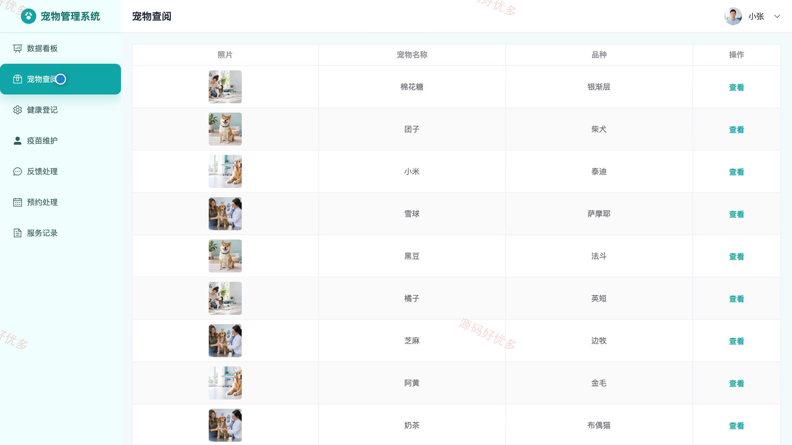
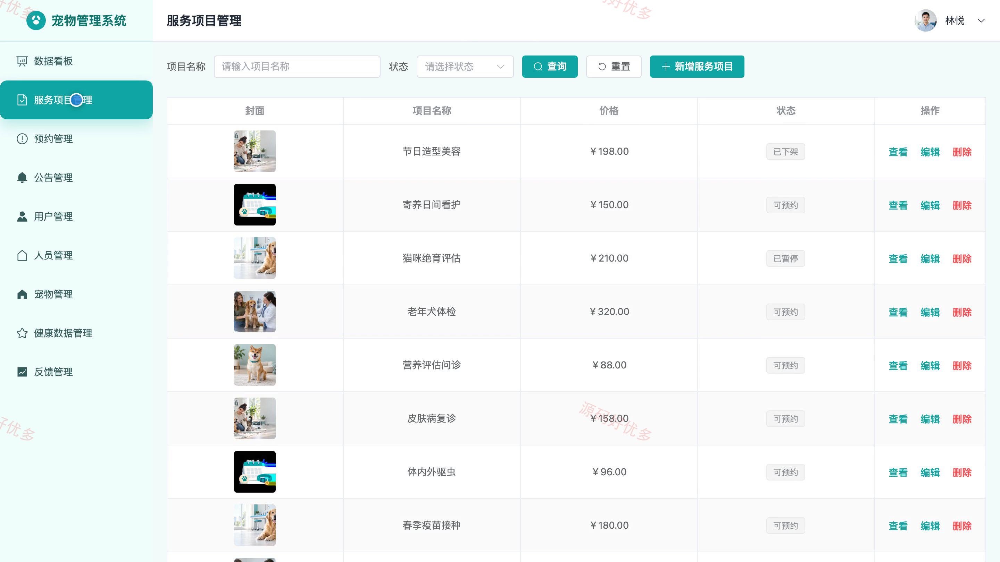
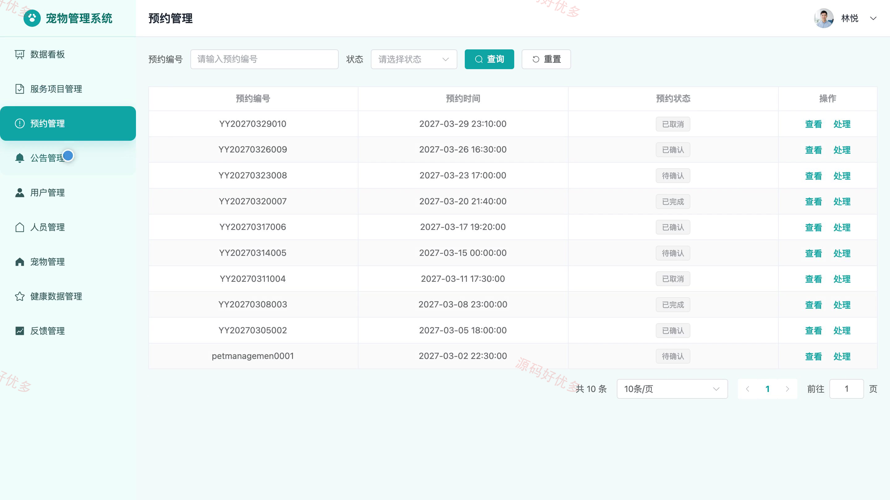

## 源码问题查看主页咨询

### 一、关键词
宠物健康档案、疫苗驱虫、宠物服务预约、宠物护理、宠物管理

### 二、作品包含
源码+数据库+万字设计文档+PPT+全套环境和工具资源+本地部署教程

### 三、项目技术
前端技术： Html、Css、Js、Vue3.4、Element-Plus
后端技术：Python、Django

### 四、运行环境要求
开发工具：PyCharm + VSCODE

数据库：MySQL5.7+（共12张表）

数据库管理工具：Navicat10以上版本

环境配置软件： Python3.9+

前端Nodejs：16+

浏览器：谷歌浏览器

### 五、项目介绍
项目编号：bs130C

系统面向宠物主人、服务人员和管理员，提供宠物档案、健康记录、疫苗驱虫、服务项目与预约等功能。宠物主人可维护宠物资料并预约服务；服务人员处理预约和健康信息；管理员维护服务项目、用户、人员与公告。

角色：宠物主人、服务人员、管理员

宠物主人功能：宠物档案管理、健康记录查看、疫苗驱虫查看、服务项目浏览与预约、预约记录查询、意见反馈。

服务人员功能：预约处理、服务记录查看、宠物档案查阅、健康登记、疫苗维护、反馈处理。

管理员功能：用户与人员管理、宠物档案管理、健康数据管理、服务项目管理、预约管理、公告管理、反馈管理、数据看板。

### 六、运行截图

